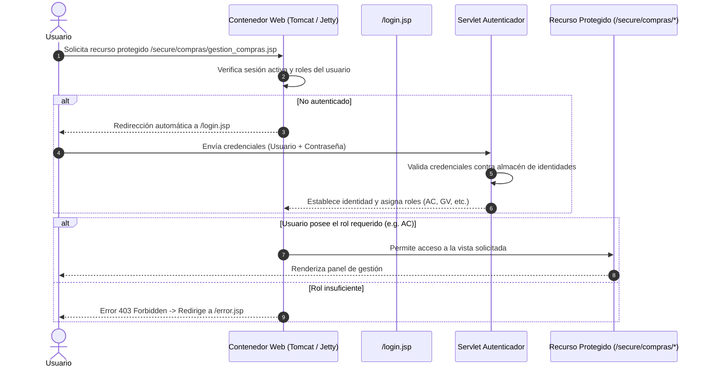

# Java Web Security: Form Authentication & Role-Based Access Control (RBAC)

[](https://www.oracle.com/java/)
[](https://en.wikipedia.org/wiki/Role-based_access_control)
[](LICENSE)

Guía educativa y aplicación de referencia para la implementación de **Seguridad Declarativa y Control de Acceso Basado en Roles (RBAC)** en aplicaciones web Java basadas en la especificación **Java EE / Servlet 3.0**.

El proyecto ilustra la segmentación modular de privilegios empresariales mediante restricciones declarativas en `web.xml` y autenticación basada en formularios (`FORM`), protegiendo rutas sensibles divididas en áreas funcionales: **Compras**, **Nóminas** y **Ventas**.

---

## 🔐 Flujo de Autenticación y Autorización



---

## 🏛️ Matriz de Roles y Control de Acceso (RBAC)

La aplicación implementa el principio de mínimo privilegio sobre las rutas seguras del contexto `/secure/`:

| Módulo | Ruta Protegida (`url-pattern`) | Rol Requerido (`security-role`) | Descripción |
|---|---|---|---|
| **Compras** | `/secure/compras/*` | `AC` *(Autorizador de Compras)* | Gestión de compras y proveedores corporativos |
| **Nóminas** | `/secure/nominas/*` | `GN` *(Gestor de Nóminas)* | Administración de nómina y trabajadores |
| **Ventas** | `/secure/ventas/*` | `GV` *(Gestor de Ventas)* | Emisión de facturas, clientes y presupuestos |
| **Menú General** | `/secure/menu.jsp` | Autenticado | Panel central de navegación según privilegios |

---

## 📂 Estructura del Proyecto

```
seguridad-jaas/
├── src/
│   └── java/
│       └── Autenticador.java      # Servlet de verificación de credenciales
├── web/
│   ├── WEB-INF/
│   │   └── web.xml               # Descriptores de despliegue, login-config y security-constraints
│   ├── secure/                   # Directorio raíz protegido
│   │   ├── compras/              # Vistas protegidas para área de compras
│   │   ├── nominas/              # Vistas protegidas para área de nóminas
│   │   ├── ventas/               # Vistas protegidas para área de ventas
│   │   └── menu.jsp              # Panel principal de navegación
│   ├── login.jsp                 # Formulario de inicio de sesión
│   ├── error.jsp                 # Manejador visual de errores HTTP 403 / 400
│   └── index.jsp                 # Bienvenida y redirección
├── build.xml                     # Script de construcción Ant
└── README.md
```

---

## 💡 Lecciones Clave de Seguridad Web

1. **Seguridad Declarativa vs. Programática:**
   La seguridad declarativa (`web.xml`) delega la intercepción y validación de URLs al contenedor web (*Servlet Container*), asegurando que ninguna solicitud alcance el código de negocio a menos que cumpla con las restricciones de rol configuradas.
2. **Manejo Centralizado de Errores de Autorización:**
   La captura explícita del código `HTTP 403` evita exponer stack traces internos del servidor de aplicaciones al usuario final.
3. **Evolución hacia Estándares Modernos:**
   Este modelo de roles y filtros declarativos constituye el fundamento conceptual sobre el cual se construyeron los interceptores de seguridad modernos de la industria, como **Spring Security** (`SecurityFilterChain`, `@PreAuthorize`), filtros JWT y estándares de autenticación abierta (**OAuth 2.0 / OIDC**).

---

## 📄 Licencia
Este proyecto es código abierto bajo la licencia [MIT](LICENSE).

**Autor:** [Kevin Andrey Herrera Silva](https://github.com/KevinAndrey96) · Bogotá, Colombia
