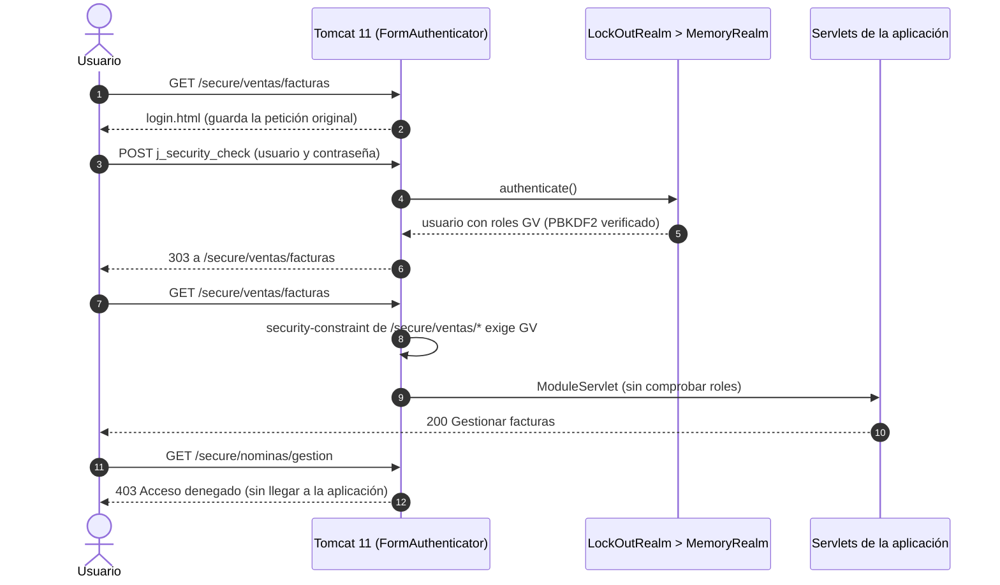

# Seguridad declarativa en Jakarta EE: login FORM y control de acceso por roles (RBAC) con Tomcat 11

[](https://github.com/KevinAndrey96/java-jakarta-ee-form-auth-rbac/actions/workflows/ci.yml)


[](LICENSE)

Aplicación web de referencia sobre **seguridad declarativa** en Jakarta EE. Un sistema de gestión con tres áreas (Compras, Nóminas y Ventas) protege cada módulo con un rol distinto, y **ninguna línea de Java decide quién entra**: las reglas viven en `web.xml` y las aplica el contenedor. Usa autenticación `FORM`, usuarios con contraseñas PBKDF2 en un realm de Tomcat con bloqueo por intentos fallidos, cabeceras de seguridad y pruebas de integración que inician sesión por HTTP sobre Tomcat embebido.

## Contenido

- [Cómo funciona](#cómo-funciona)
- [Roles y módulos](#roles-y-módulos)
- [Uso](#uso)
- [Usuarios y contraseñas](#usuarios-y-contraseñas)
- [Defectos de la versión de 2017 corregidos](#defectos-de-la-versión-de-2017-corregidos)
- [Estructura](#estructura)
- [Pruebas y calidad](#pruebas-y-calidad)
- [Historia del proyecto](#historia-del-proyecto)

## Cómo funciona



- **Autenticación:** `<login-config>` con `FORM`, páginas `login.html` y `login-error.html`.
- **Autorización:** un `<security-constraint>` por grupo de módulos. `/secure/*` exige cualquiera de los cuatro roles y las rutas más específicas exigen el rol del módulo, siguiendo la regla de coincidencia de la especificación Servlet (ruta exacta antes que prefijo más largo). `<deny-uncovered-http-methods/>` rechaza los métodos que no cubre ninguna regla.
- **Identidades:** `META-INF/context.xml` declara un `LockOutRealm` (cinco fallos bloquean la cuenta cinco minutos) que envuelve un `MemoryRealm`. El archivo de usuarios queda fuera de la aplicación y se indica con la propiedad `users.file`.
- **Contraseñas:** `SecretKeyCredentialHandler` con PBKDF2WithHmacSHA512, 210.000 iteraciones, sal de 16 bytes y clave de 256 bits.
- **Sesión y navegador:** cookie `HttpOnly` y `SameSite=Strict`, solo por cookie (sin `jsessionid` en la URL), y un filtro que añade `Content-Security-Policy`, `X-Frame-Options: DENY`, `X-Content-Type-Options: nosniff`, `Referrer-Policy: no-referrer` y `Cache-Control: no-store`.
- **Menú:** `MenuServlet` marca cada módulo como permitido o sin acceso con `isUserInRole`. Es solo presentación: aunque el usuario abra un enlace marcado sin acceso, el contenedor responde 403.
- **Cierre de sesión:** `POST /secure/salir` llama a `request.logout()` e invalida la sesión. Un `GET` responde 405, así un enlace o una imagen de otro sitio no puede cerrar la sesión.

## Roles y módulos

| Rol | Nombre | Módulos |
| :-- | :-- | :-- |
| `AC` | Autorización de compras | `/secure/compras/autorizar` |
| `GC` | Gestión de compras | `/secure/compras/gestion`, `/secure/compras/proveedores` |
| `GN` | Gestión de nóminas | `/secure/nominas/gestion`, `/secure/nominas/trabajadores` |
| `GV` | Gestión de ventas | `/secure/ventas/clientes`, `/secure/ventas/facturas`, `/secure/ventas/presupuestos` |

Un usuario puede tener varios roles. El catálogo de módulos está en el enum `Module` y una prueba comprueba que coincide con las reglas de `web.xml`.

## Uso

### Con Docker

```bash
docker compose up --build
```

Abre <http://localhost:8080> e inicia sesión con un usuario de demostración. La contraseña de cada uno es su nombre seguido de `-demo`:

| Usuario | Contraseña | Roles |
| :-- | :-- | :-- |
| `autoriza` | `autoriza-demo` | AC |
| `compras` | `compras-demo` | GC |
| `nominas` | `nominas-demo` | GN |
| `ventas` | `ventas-demo` | GV |
| `gerencia` | `gerencia-demo` | GC, GN |

La imagen compila el WAR con Maven y lo despliega como `ROOT.war` en Tomcat 11 con Java 21, ejecutándose con un usuario sin privilegios. Con el contenedor arriba, `./scripts/smoke-test.sh` inicia sesión como `ventas` y comprueba los 200, los 403 y el cierre de sesión con `curl`.

### Con Maven

Requiere Java 17 o superior y Maven 3.9.

```bash
mvn verify
```

Compila con `-Xlint:all -Werror`, ejecuta las pruebas (incluidas las de integración sobre Tomcat embebido) y genera `target/rbac.war`, que se despliega en cualquier Tomcat 11 arrancado con `-Dusers.file=/ruta/a/users.xml`. Las páginas usan rutas absolutas, así que la aplicación espera desplegarse en la raíz (`ROOT.war`).

## Usuarios y contraseñas

El archivo de usuarios sigue el formato de `tomcat-users.xml`. Parte de [`config/users.example.xml`](config/users.example.xml), guárdalo como `config/users.xml` (ignorado por Git) y genera cada hash con:

```bash
./scripts/hash-password.sh
```

El script pide la contraseña sin mostrarla ni dejarla en el historial y ejecuta el `digest.sh` oficial de Tomcat con los mismos parámetros del `CredentialHandler`. Para usarlo en Docker, monta tu archivo en `/config/users.xml`.

## Defectos de la versión de 2017 corregidos

| Versión de 2017 | Ahora |
| :-- | :-- |
| Usuarios y contraseñas en texto plano en `Usuarios.txt`, publicado dentro de `build/` y del WAR | Hashes PBKDF2 en un archivo externo a la aplicación, fuera del control de versiones |
| Servlet `Autenticador` que leía ese archivo con `substring` e `indexOf` frágiles y que el `login-config` ni siquiera usaba | Sin código de autenticación propio: lo hace el realm del contenedor |
| `menu.jsp` repetido en cada `security-constraint`, lo que obligaba a tener todos los roles a la vez para ver el menú | Una regla general para `/secure/*` y reglas específicas por módulo |
| `error-page` 400 apuntando al menú para esconder el error de enviar el login sin petición previa | `landingPage` del `FormAuthenticator`: el envío directo vuelve al formulario en `/secure/menu` |
| Cierre de sesión por `GET ?logoff` | `POST /secure/salir` con `request.logout()`; `GET` responde 405 |
| Sin límite de intentos | `LockOutRealm`: cinco fallos bloquean la cuenta cinco minutos |
| Sin cabeceras de seguridad y cookie de sesión sin `SameSite` | Filtro de cabeceras, cookie `HttpOnly` y `SameSite=Strict` |
| Java EE 6 (`javax.servlet`), proyecto de NetBeans con Ant y binarios versionados | Jakarta Servlet 6.1, Maven, Docker y CI, sin binarios en el historial |
| Sin pruebas | 14 pruebas, incluidas las de integración por HTTP |

## Estructura

```text
src/main/java/com/kevinandrey/rbac/
  Role.java                   roles AC, GC, GN y GV
  Module.java                 catálogo de módulos: ruta, área, título y rol
  MenuServlet.java            menú con marcas de permitido y sin acceso
  ModuleServlet.java          páginas de los módulos, sin lógica de autorización
  LogoutServlet.java          cierre de sesión por POST
  ForbiddenServlet.java       página 403
  SecurityHeadersFilter.java  cabeceras de seguridad
  Html.java                   escape y plantilla HTML
src/main/webapp/
  WEB-INF/web.xml             restricciones, roles y login FORM
  META-INF/context.xml        realm, hash de contraseñas, landing page y cookies
  login.html, login-error.html, index.html, estilos.css
config/users.example.xml      usuarios de demostración
scripts/                      hash de contraseñas y prueba de humo
```

## Pruebas y calidad

- `SecurityIntegrationTest` arranca la aplicación real en Tomcat 11 embebido (puerto libre, archivo de usuarios temporal con hashes PBKDF2) y la recorre como un navegador con `java.net.http.HttpClient` y cookies:
  - visitantes anónimos reciben el formulario;
  - cada usuario recibe 200 en sus módulos y 403 en todos los demás (cinco usuarios por ocho módulos, incluido uno con dos roles);
  - el menú marca bien lo permitido;
  - una ruta desconocida da 404 a quien tiene el rol del área y 403 a quien no;
  - una contraseña errónea muestra la página de error y cinco fallos bloquean la cuenta;
  - el login enviado sin petición previa vuelve al formulario;
  - el cierre de sesión solo acepta POST;
  - las cabeceras de seguridad están presentes y los estáticos son públicos.
- `WebXmlTest` lee `web.xml`, aplica la regla de coincidencia de URL de la especificación y comprueba que cada módulo del enum queda protegido exactamente por su rol.
- CI en GitHub Actions con Java 17, 21 y 25 más un trabajo que construye la imagen Docker y ejecuta la prueba de humo. Dependabot vigila Maven y las acciones.

## Historia del proyecto

Nació en abril de 2017 como práctica universitaria de seguridad en aplicaciones web Java EE (proyecto de NetBeans `Practica`, con páginas JSP y usuarios de prueba inspirados en *The Walking Dead*). En 2026 se reescribió por completo sobre Jakarta EE conservando la idea original: tres áreas de negocio, los mismos cuatro roles y la seguridad declarada en `web.xml`. El commit original de 2017 se conserva en la etiqueta `v0.1-java-coursework-2017`. El historial se depuró para quitar `build/`, `dist/` y los archivos de NetBeans, que incluían el archivo de usuarios con contraseñas en texto plano.

## Licencia

[MIT](LICENSE) © 2017-2026 Kevin Andrey Herrera Silva
